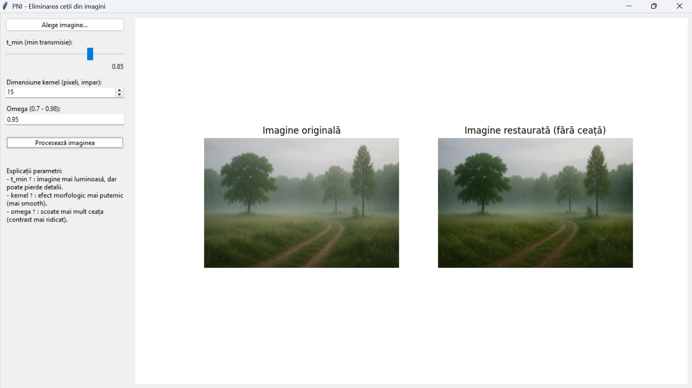

# Image Dehazing by Mathematical Morphology

An interactive desktop application for image haze removal and contrast restoration, built with **Python**, **OpenCV**, and a **Tkinter** GUI. The project implements an efficient hybrid pipeline that couples the physical **Dark Channel Prior (DCP)** model with fast **Mathematical Morphology** operations (Closing & Opening) to refine transmission maps without the computational cost of traditional soft matting.

---

## Application Interface



*Interactive side-by-side comparison between the original hazy input and the restored contrast-enhanced output, complete with real-time parameter tuning and detailed diagnostic visualizations.*

---

## Methodological Overview

Haze degrades scene visibility, reduces edge contrast, and impairs autonomous vision systems by superimposing atmospheric airlight onto the scene. 

### 1. Atmospheric Optical Model
The degradation is modeled using the standard atmospheric scattering equation:
$$I(x) = J(x) \cdot t(x) + A \cdot (1 - t(x))$$

Where:
* **$I(x)$**: Observed hazy image
* **$J(x)$**: Recovered haze-free scene radiance
* **$A$**: Global atmospheric light
* **$t(x)$**: Medium transmission map governed by Beer-Lambert law ($t(x) = e^{-\beta d(x)}$)

### 2. Dark Channel Prior (DCP)
Based on the observation that haze-free outdoor images contain pixels with near-zero intensity in at least one color channel:
$$J^{dark}(x) = \min_{y \in \Omega(x)} \left( \min_{c \in \{R,G,B\}} I^c(y) \right)$$

This provides an initial coarse transmission estimate $t_1(x)$:
$$t_1(x) = 1 - \omega \cdot \min_{y \in \Omega(x)} \left( \min_c \frac{I^c(y)}{A^c} \right)$$

### 3. Fast Morphological Refinement
Standard methods rely on complex, computationally expensive edge-preserving filters (e.g., Soft Matting or Guided Filtering). This project accelerates the pipeline by applying sequential morphological filters:
1. **Closing:** Fills holes and unifies continuous structural surfaces.
2. **Opening:** Removes sparse noise spikes, producing a smooth transmission map $t_{refined}(x)$ while respecting object boundaries.

### 4. Scene Radiance Recovery
The final clean image is reconstructed by inverting the optical model bounded by a safety floor $t_{min}$ to avoid noise amplification in dense haze regions[cite: 12]:
$$J(x) = \frac{I(x) - A}{\max(t_{refined}(x), t_{min})} + A$$

---

## Key Features & GUI Controls

* **Interactive Side-by-Side Preview:** Instant before/after comparison.
* **Tunable Pipeline Parameters:**
  * **$t_{min}$ (0.5 – 0.85):** Transmission floor; prevents division by zero and controls detail retention vs. residual haze.
  * **Kernel Size (15 – 31 px):** Morphological structuring element size. Smaller kernels preserve fine details, while larger kernels provide stronger smoothing across broad planes.
  * **Omega ($\omega$, 0.70 – 0.98):** Controls atmospheric depth perception; retains a subtle layer of natural haze to preserve realism.
* **Detailed Diagnostics:** Separate windows for inspecting morphological filters (Erosion, Dilation, Opening, Closing), grayscale histograms, and intermediate transmission stages.

---

## Tech Stack

* **Language:** Python
* **Computer Vision:** OpenCV (`cv2`), NumPy, SciPy
* **GUI / Plotting:** Tkinter, Matplotlib

---

## Getting Started

### Prerequisites
Make sure Python 3.9+ is installed on your machine.

### Installation
1. Clone this repository:
   ```bash
   git clone [https://github.com/claudiajakab22/image-dehazing-interface.git](https://github.com/claudiajakab22/image-dehazing-interface.git)
   cd image-dehazing-interface
